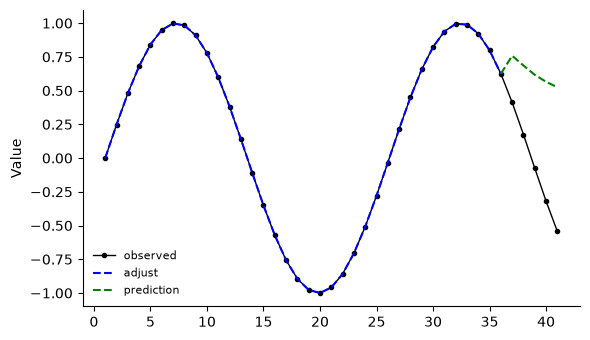

# Multivariate forecasting with PyTorch MLP


```python
import numpy as np
import pandas as pd
import pytspredit as ts
from pydaltoolboxdp import TorchTsMlp

y = ts.datasets.tsd()["y"].to_numpy()
x1 = np.concatenate([y[1:], y[-1:]])
mv = ts.ts_data_mv(pd.DataFrame({"y": y, "x1": x1}), y="y")
sample = ts.ts_sample(mv, test_size=5)
make = lambda seed: TorchTsMlp(hidden_sizes=[6], dropout=0.0, epochs=5,
                                batch_size=8, learning_rate=0.01, random_state=seed)
model = ts.TsRegswMv(
    model_y=ts.ts_mv_spec(make(43), variables=["y", "x1"]),
    models_x={"x1": ts.ts_mv_spec(make(47))}, window_size=5,
).fit(sample.train)
prediction = model.predict(steps_ahead=5)
prediction.system
```


<div>
<style scoped>
    .dataframe tbody tr th:only-of-type {
        vertical-align: middle;
    }

    .dataframe tbody tr th {
        vertical-align: top;
    }

    .dataframe thead th {
        text-align: right;
    }
</style>
<table border="1" class="dataframe">
  <thead>
    <tr style="text-align: right;">
      <th></th>
      <th>y</th>
      <th>x1</th>
    </tr>
  </thead>
  <tbody>
    <tr>
      <th>0</th>
      <td>0.758268</td>
      <td>0.173478</td>
    </tr>
    <tr>
      <th>1</th>
      <td>0.685704</td>
      <td>-0.014610</td>
    </tr>
    <tr>
      <th>2</th>
      <td>0.616635</td>
      <td>-0.197683</td>
    </tr>
    <tr>
      <th>3</th>
      <td>0.565318</td>
      <td>-0.342005</td>
    </tr>
    <tr>
      <th>4</th>
      <td>0.524512</td>
      <td>-0.430327</td>
    </tr>
  </tbody>
</table>
</div>


```python
ts.plot_ts_pred_mv(sample.train, sample.test, prediction, variable="y")
```


    

    


    

    

