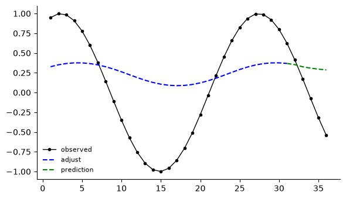

# LSTM time-series forecasting

`TsLstm` processes a lag window as a sequence and forecasts through its final recurrent state.


```python
import numpy as np
import pytspredit as ts
from pydaltoolboxdp import TsLstm

windows = ts.ts_data(ts.datasets.tsd()["y"], 6)
sample = ts.ts_sample(windows, test_size=5)
train, test = ts.ts_projection(sample.train), ts.ts_projection(sample.test)
model = TsLstm(
    ts.TsNormGminmax(), input_size=5, hidden_size=5, sequence_length=5,
    epochs=8, batch_size=8, learning_rate=0.01, random_state=41,
).fit(train.input, train.output)
prediction = model.predict(test.input.iloc[[0]], steps_ahead=5)
model.evaluate(test.output.to_numpy().ravel(), prediction)["metrics"]
```


<div>
<style scoped>
    .dataframe tbody tr th:only-of-type {
        vertical-align: middle;
    }

    .dataframe tbody tr th {
        vertical-align: top;
    }

    .dataframe thead th {
        text-align: right;
    }
</style>
<table border="1" class="dataframe">
  <thead>
    <tr style="text-align: right;">
      <th></th>
      <th>mse</th>
      <th>smape</th>
      <th>R2</th>
    </tr>
  </thead>
  <tbody>
    <tr>
      <th>0</th>
      <td>0.248532</td>
      <td>1.352779</td>
      <td>-1.14658</td>
    </tr>
  </tbody>
</table>
</div>


```python
adjusted = model.predict(train.input)
y = np.concatenate([train.output.to_numpy().ravel(), test.output.to_numpy().ravel()])
ts.plot_ts_pred(y=y, yadj=adjusted, ypred=prediction)
```


    

    


    

    


References: Hochreiter & Schmidhuber (1997); Paszke et al. (2019).
